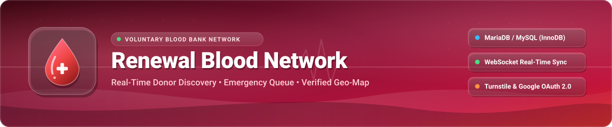
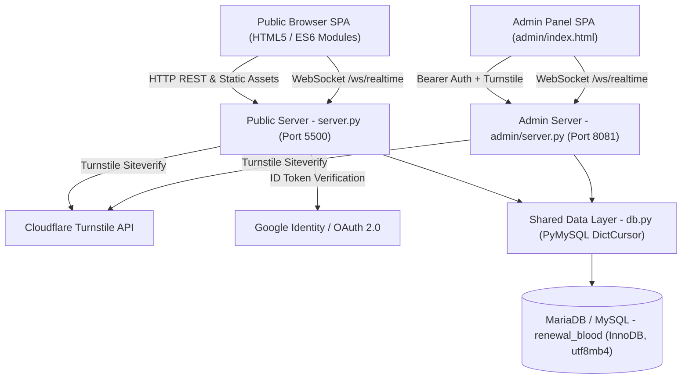
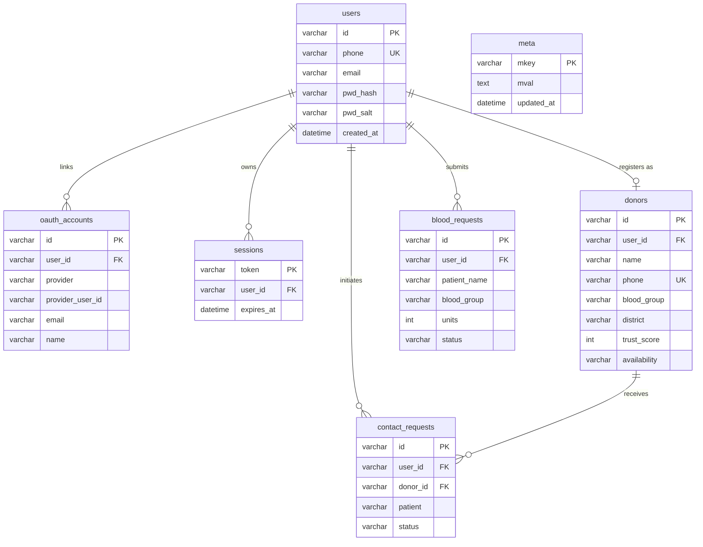

<div align="center">

<!-- 3D Gradient Hero Header (Repo-Hosted SVG — Zero External Proxy Dependency) -->


<h3>🩸 রক্তের প্রয়োজনে, মানুষের পাশে &nbsp;•&nbsp; Real-Time Voluntary Blood Donor Network</h3>

<!-- Bold For-The-Badge Tech Stack -->
<p>
  
  
  
  
</p>
<p>
  
  
  
  
</p>

<!-- 3D Glossy (Plastic Style) Supported Blood Groups -->
<p>
  
  
  
  
  
  
  
  
  
</p>

<!-- Quick Navigation Links -->
<p>
  <a href="#-key-features">Features</a> &nbsp;&bull;&nbsp;
  <a href="#%EF%B8%8F-system-architecture">Architecture</a> &nbsp;&bull;&nbsp;
  <a href="#-database-schema">Database Schema</a> &nbsp;&bull;&nbsp;
  <a href="#-quick-start">Quick Start</a> &nbsp;&bull;&nbsp;
  <a href="#-api-endpoints">API Reference</a> &nbsp;&bull;&nbsp;
  <a href="#-security-model">Security</a>
</p>

</div>

---

> [!IMPORTANT]
> **Renewal Blood Network (রিনিউয়েল ব্লাড নেটওয়ার্ক)** is a full-stack, bilingual (**Bengali + English**) voluntary blood donation platform built for fast donor discovery across all districts and upazilas of Bangladesh, emergency blood request verification, real-time WebSocket synchronization, and dedicated admin moderation.

---

## ✨ Key Features

| Module | Capabilities |
| :--- | :--- |
| **🩸 Smart Donor Discovery** | Multi-criteria filtering by blood group, district, upazila, neighborhood area, and availability (`available` / `soon`), ranked by dynamic **Trust Score**. |
| **🗺️ Interactive Geo-Map** | Built with **Leaflet.js (`1.9.4`)** to visualize registered donors and regional coverage across active districts on an interactive map. |
| **📝 3-Step Donor Onboarding** | Guided multi-step donor registration with inline phone collision detection, optional Google profile autofill, donation eligibility tracking, and 4-digit PIN security. |
| **🚨 Emergency Blood Queue** | Public emergency blood request submission with hospital details, unit count, attendant phone, anti-bot verification, and community reporting. |
| **⚡ Real-Time WebSocket Sync** | Dual-server live updates over `/ws/realtime` backed by atomic versioning in the `meta` table — dashboards, donor lists, and admin queues stay synchronized instantly. |
| **🔐 Google OAuth 2.0 & PIN Auth** | Seamless one-click Google Sign-In / account linking (`oauth_accounts`), paired with salted `scrypt` 4-digit PIN authentication and 30-day HTTP Bearer sessions. |
| **🛡️ Cloudflare Turnstile Guard** | Bot protection enforced at Step 1 of Registration, Login, Emergency Request, Donor Contact Request, and Admin Authentication. |
| **🏆 Trust Score & Leaderboard** | Automated trust score engine (`calc_trust_score`) based on verification levels (`0–4`), donation history, and zero-report standing, powering community leaderboards. |
| **🛠️ Dedicated Admin Console** | Standalone management portal on port `8081` (`admin/`) to verify emergency blood requests, manage donor verification tiers, inspect suspicious flags, and review contact leads. |

---

## 🏗️ System Architecture

Both the **Public Web Server** (`server.py` on port `5500`) and the **Admin Dashboard Server** (`admin/server.py` on port `8081`) share the unified [`db.py`](db.py) MySQL/MariaDB data access layer and synchronize state in real time.



---

## 🗄️ Database Schema

All relational data is stored in **MySQL / MariaDB** using `InnoDB` with `utf8mb4_unicode_ci` encoding for complete Bengali Unicode support.



<details>
<summary><b>📂 Click to expand Full Project Directory Structure</b></summary>

```text
blood_bank_website/
├── .env.example            # Safe environment configuration template
├── assets/
│   ├── header.svg          # 3D gradient hero SVG banner
│   └── footer.svg          # Custom wave SVG footer
├── db.py                   # Pure MySQL/MariaDB driver, schema auto-init & data models
├── server.py               # Public REST API, WebSocket sync & SPA server (Port 5500)
├── requirements.txt        # Python dependencies (Flask, flask-sock, pymysql, cryptography)
├── index.html              # Public Single-Page Application entry point
├── start-server.bat        # Windows launcher for Public Server
├── start-admin.bat         # Windows launcher for Admin Server
├── css/
│   ├── main.css            # Design tokens, variables & layout base
│   ├── animations.css      # UI transitions & micro-animations
│   ├── components.css      # Reusable cards, modals, wizard steps & badges
│   └── pages.css           # Page-specific styling (map, dashboard, leaderboard)
├── js/
│   ├── app.js              # SPA router, auth modal, Google OAuth & global notifications
│   ├── data.js             # REST & WebSocket client store with local session sync
│   ├── donor.js            # 3-step registration wizard, search & donor contact modal
│   ├── emergency.js        # Emergency request queue & submission wizard
│   ├── dashboard.js        # Authenticated donor profile, availability & history editor
│   ├── map.js              # Leaflet interactive donor map integration
│   └── leaderboard.js      # Verified donor trust leaderboard
└── admin/
    ├── server.py           # Admin REST API & SPA server (Port 8081)
    ├── index.html          # Admin Control Panel UI
    ├── css/                # Admin stylesheet suite
    └── js/
        ├── app.js          # Admin SPA shell
        ├── admin.js        # Moderation workflows, Turnstile verification & CRUD actions
        └── data.js         # Admin authenticated API client
```

</details>

---

## 🚀 Quick Start

### 1. Prerequisites
- **Python 3.10+**
- **MySQL 8.0+** or **MariaDB 10.6+ / 13.x** running locally or remotely

### 2. Install Dependencies
```bash
pip install -r requirements.txt
```

### 3. Provision Database & Configure Environment
Create an empty database named `renewal_blood` in MariaDB / MySQL:
```sql
CREATE DATABASE IF NOT EXISTS renewal_blood
  CHARACTER SET utf8mb4
  COLLATE utf8mb4_unicode_ci;
```

Copy `.env.example` to `.env` and fill in your credentials:
```bash
cp .env.example .env
```

> [!TIP]
> **Schema Auto-Initialization:** When either `server.py` or `admin/server.py` starts for the first time, [`db.py`](db.py) automatically calls `init_db()` to create all 7 tables, foreign keys, and performance indexes in MariaDB/MySQL.

<details>
<summary><b>⚙️ Environment Variables Reference (<code>.env</code>)</b></summary>

| Variable | Description | Example / Default |
| :--- | :--- | :--- |
| `DB_TYPE` | Active database engine | `mysql` |
| `DB_HOST` | MariaDB / MySQL server host | `127.0.0.1` |
| `DB_PORT` | MariaDB / MySQL port | `3306` |
| `DB_USER` | Database user | `root` |
| `DB_PASSWORD` | Database password *(keep strictly in `.env`)* | `your_database_password` |
| `DB_NAME` | Target database schema name | `renewal_blood` |
| `ADMIN_PASSWORD` | Admin panel login password *(Port `8081`)* | `your_admin_password` |
| `CLOUDFLARE_TURNSTILE_SITE_KEY` | Public Cloudflare Turnstile Site Key | `1x00000000000000000000AA` *(test)* |
| `CLOUDFLARE_TURNSTILE_SECRET_KEY` | Private Cloudflare Turnstile Secret Key | `1x0000000000000000000000000000000AA` *(test)* |
| `TURNSTILE_ENABLED` | Toggle Turnstile server-side validation | `true` |
| `GOOGLE_CLIENT_ID` | Google OAuth 2.0 Web Client ID | `your-client-id.apps.googleusercontent.com` |
| `GOOGLE_LOGIN_ENABLED` | Enable/disable Google Sign-In flow | `true` |

</details>

### 4. Run the Servers

Start the **Public Website & API** (http://localhost:5500):
```bash
python server.py --port 5500
# Or on Windows: start-server.bat
```

Start the **Admin Dashboard Server** (http://localhost:8081) in another terminal:
```bash
cd admin
python server.py --port 8081
# Or on Windows: start-admin.bat
```

---

## 📡 API Endpoints

<details>
<summary><b>🔌 Click to view Public REST API, Admin API & WebSocket Endpoints</b></summary>

### Public Server (`http://localhost:5500`)
| Method | Endpoint | Description |
| :--- | :--- | :--- |
| `GET` | `/api/health` | Service health & uptime status |
| `GET` | `/api/config` | Public client config (Turnstile & Google OAuth flags) |
| `GET` | `/api/realtime/version` | Current `data_version` and live aggregate donor/request metrics |
| `WS` | `/ws/realtime` | Real-time push notifications whenever database records change |
| `POST` | `/api/auth/signup` | Register user account with phone, 4-digit PIN & Turnstile verification |
| `POST` | `/api/auth/login` | Authenticate via phone & PIN + Turnstile verification |
| `POST` | `/api/auth/google` | Verify Google ID Token and sign in / auto-create or link user |
| `GET` | `/api/auth/me` | Return current authenticated user profile (`Bearer` token) |
| `GET` | `/api/auth/check-phone` | Check if a phone number is already registered |
| `POST` | `/api/auth/logout` | Invalidate active session token |
| `GET` | `/api/donors` | List registered donors (with public phone masking applied) |
| `GET` | `/api/donors/search` | Filter donors by `bloodGroup`, `district`, `upazila`, `area`, `availability` |
| `POST` | `/api/donors` | Create donor profile (supports linked user & Turnstile) |
| `GET` / `PUT` | `/api/donors/<id>` | Fetch or update donor profile & availability |
| `GET` / `POST` | `/api/requests` | List or submit urgent blood requests |
| `PUT` | `/api/requests/<id>` | Update or flag/report an existing request |
| `GET` / `POST` | `/api/contacts` | List or send donor contact request |
| `PUT` | `/api/contacts/<id>` | Update contact request status |

### Admin Server (`http://localhost:8081`)
| Method | Endpoint | Description |
| :--- | :--- | :--- |
| `POST` | `/api/admin/login` | Authenticate with `ADMIN_PASSWORD` + Turnstile CAPTCHA |
| `GET` / `PUT` | `/api/donors`, `/api/donors/<id>` | Full unmasked donor moderation, verification levels & trust updates |
| `GET` / `PUT` | `/api/requests`, `/api/requests/<id>` | Approve, verify, or reject emergency blood requests |
| `GET` / `PUT` | `/api/contacts`, `/api/contacts/<id>` | Monitor and resolve donor-patient contact requests |

</details>

---

## 🔒 Security Model

> [!NOTE]
> Security hygiene is built into both runtime execution and repository configuration:

- **Zero Hardcoded Secrets:** Database passwords, Turnstile secret keys, Google Client IDs, and Admin passwords are loaded exclusively from `.env` and never committed to Git.
- **Cryptographic PIN Storage:** User 4-digit PINs are hashed with Python's native `hashlib.scrypt` (`N=16384, r=8, p=1, dklen=64`) using unique per-user random 16-byte salts.
- **Public Privacy Masking:** Public donor directory responses mask phone numbers (`0171***233`) unless viewed through verified/authenticated workflows.
- **SQL Injection Safe:** Every MariaDB/MySQL query uses parameterized prepared-statement bindings (`%s`) wrapped cleanly inside [`MySQLCursorWrapper`](db.py) with transactional commit/rollback guards.

---

<div align="center">

<!-- 3D Wave Footer (Repo-Hosted SVG) -->


</div>
